# MOD550 Assignment 2: Bayesian Thinking and Classification

## Task 1: Synthetic data

The dataset, descriptive tables and plots are generated by `src/task1_generate.py`.

### Objective

Create a reproducible dataset with at least 1,000 observations, a binary target
with 15–35% positives, four numerical features with the specified distribution
patterns, and a categorical feature with at least four levels. Explore how the
features relate to the target and report class balance and category counts.

### Development steps

1. Define the maize pest scenario and the feature distributions.
2. Generate plant positions and assign exactly 300 unhealthy plants.
3. Generate four numerical features and one treatment category per plant.
4. Summarize class balance, category counts and numerical patterns.
5. Save the data, plots and summary tables; discuss the observed patterns.

### Scenario and geographical setting

We continue Assignment 1’s synthetic French maize-field scenario, simulating a pest-affected harvest year. Since the original README and generator provide no coordinates or boundaries, the map uses normalized relative positions (0–1), not real geographic data. These newly simulated positions represent the same conceptual field, not a surveyed boundary.

Each row represents one sampled maize plant, with ear length measured at
harvest and illustrative leaf measurements from the affected growing season.
We assume the pest attack starts early enough to affect ear development 
and enters from the western edge (`x_position = 0`). We generate uniformly
distributed positions, then select exactly 300 unhealthy plants without
replacement using weights `exp(-4 * x_position)`. Selection is more likely near
the western edge, with overlap between healthy and unhealthy plants throughout
the field. The weights are not individual disease probabilities.

There are 1,200 observations: `y = 0` means healthy and `y = 1` means unhealthy
due to pest attack. Thus, the positive class is 25% of the observations.
If a Boolean healthy indicator is needed, use `healthy = (y == 0)`.

Figure 1 shows the simulated plant locations and the greater concentration of unhealthy plants near the western edge.

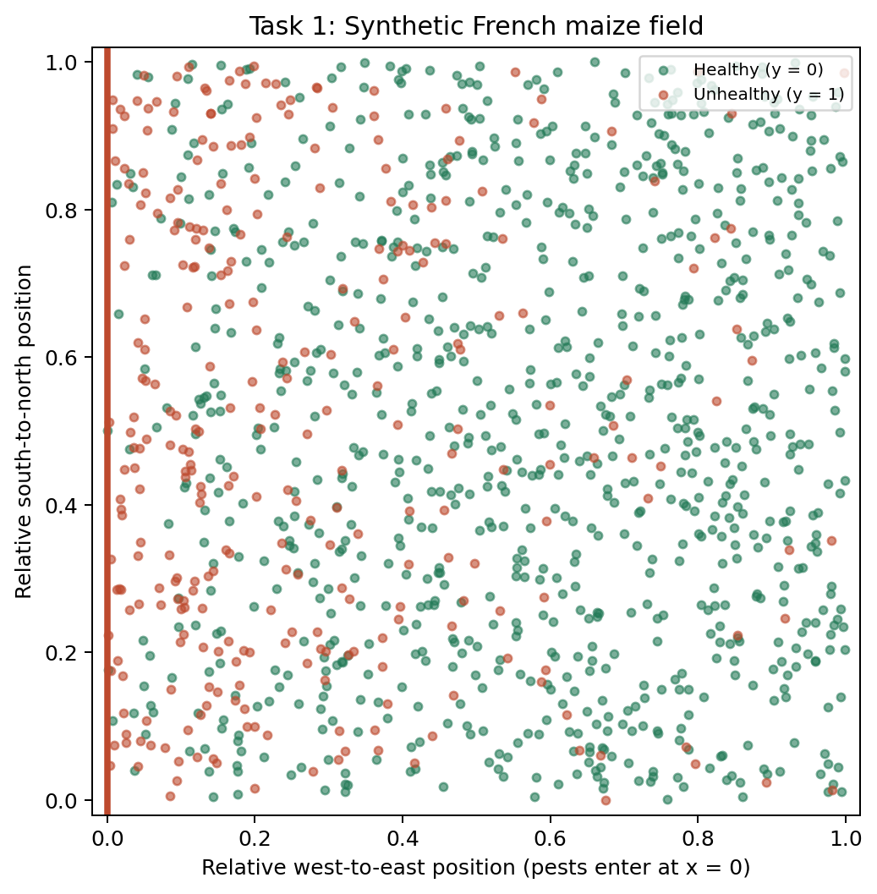

*Figure 1. Relative plant positions in the synthetic maize field. Green represents healthy plants and orange represents unhealthy plants. Coordinates range from 0 to 1 and do not denote real geographical locations.*

### Feature definitions and generation

`N(mean, variance)` below describes the theoretical generating distribution.

| Column | Meaning | Generation |
|---|---|---|
| `f1` | Ear length, cm | Healthy: N(20, 4); unhealthy: N(15, 4). Both standard deviations are 2 cm. |
| `f2` | Standardized leaf reflectance anomaly | Healthy: N(0, 0.49). Unhealthy: equal mixture of N(-3, 0.49) and N(3, 0.49). |
| `f3` | Standardized leaf pigment deviation | N(0, 1) in both classes, jointly generated with f4. |
| `f4` | Standardized leaf fluorescence deviation | N(0, 1) in both classes; correlation with f3 is -0.8 for healthy and +0.8 for unhealthy plants. |
| `cat` | Pest-management treatment | Four levels with exact class-dependent counts shown below. |

For `f2`, each of the three Gaussian components has standard deviation 0.7:
the one healthy component and the two unhealthy components. The unhealthy
mixture contains exactly 150 draws from each component, shuffled among the
300 unhealthy plants. These two hypothetical damage responses create low and
high reflectance anomalies. They are not measured pest subtypes.

For `f3` and `f4`, generate independent standard normal variables z1 and z2:

```text
f3 = z1
f4 = rho*z1 + sqrt(1-rho**2)*z2
rho = -0.8 for y=0; +0.8 for y=1
```

This construction gives both features the same symmetric N(0, 1) marginal
distribution in each class. Their joint pattern differs: matching signs are
usual for unhealthy plants and opposing signs for healthy plants. Correlations
below magnitude 1 produce the required overlap. Individual finite samples
will not have exactly identical means or standard deviations.

Ear length is sampled directly from the Gaussian distributions, without clipping
or truncation. The smaller mean for unhealthy plants represents reduced ear
development in this synthetic story. All parameter values and leaf responses
are illustrative assumptions, not calibrated agricultural estimates.

Figure 2 shows the numerical feature distributions within each health class.

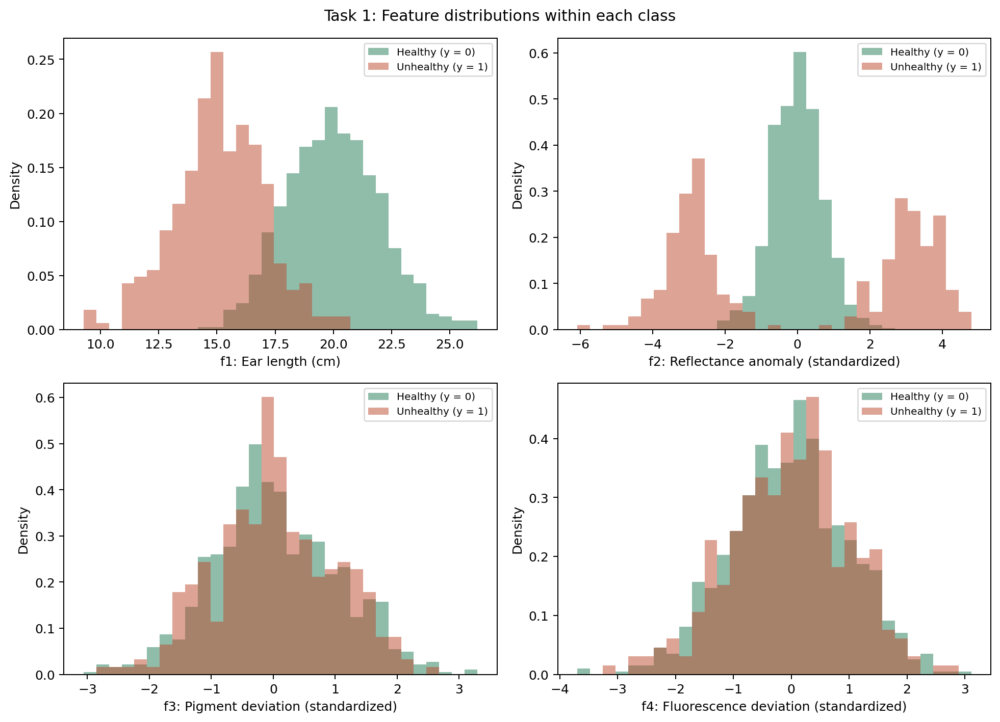

*Figure 2. Class-normalized density histograms of f1–f4. Green represents healthy plants and orange represents unhealthy plants; each class histogram has unit total area.*

Figure 3 shows the joint f3 and f4 distributions by class.

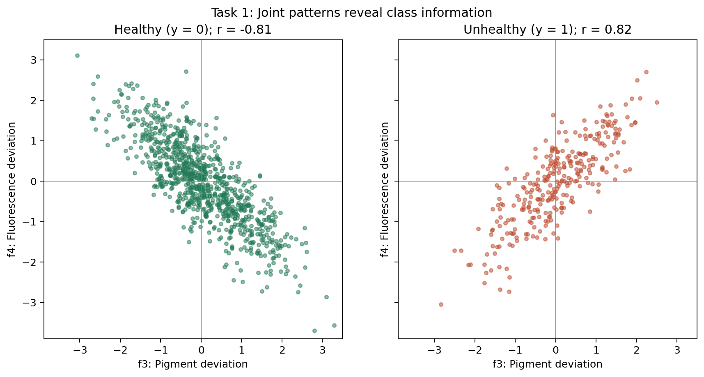

*Figure 3. Pigment (f3) versus fluorescence (f4) deviations by health class. Zero lines divide the sign combinations, and r denotes the within-class sample correlation.*

### Class balance

Table 1 summarizes the class balance: 900 plants are healthy (75%) and 300 are unhealthy (25%).


*Table 1. Class counts and percentages among the 1,200 synthetic plants. Class 0 is healthy and class 1 is unhealthy.*

### Category counts per class

Table 2 reports treatment-category counts and percentages within each health class.
Percentages use the respective totals of 900 healthy and 300 unhealthy plants.
Treatment labels are shuffled within classes, so the table encodes a deliberately chosen association.
Enhanced protection is common among healthy plants (270) but occurs in only
three unhealthy plants, meeting the requirement of at most five. Because class
labels and categories are generated by design, these numbers do not establish
real treatment effectiveness. Treatments are not simulated as contiguous plots.


*Table 2. Treatment-category counts and percentages by health class. Percentages use the total within the respective class: 900 healthy or 300 unhealthy plants.*

Figure 4 compares treatment frequencies after accounting for the unequal class sizes.

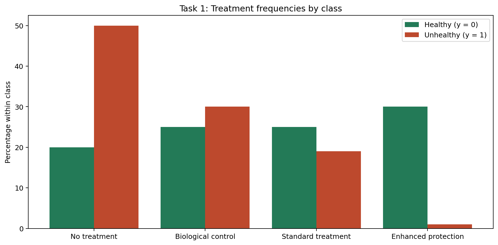

*Figure 4. Treatment-category percentages within each health class. Green represents healthy plants and orange represents unhealthy plants. The associations are imposed by the synthetic design and do not establish treatment effectiveness.*

### Numerical summaries

Mean ear lengths are 20.011 cm (healthy) and 15.124 cm (unhealthy), with sample
standard deviations of 1.984 and 1.959 cm. The sample correlations between f3
and f4 are -0.814 and +0.817; matching signs occur in 20.7% and 78.7% of plants,
respectively. Mean relative west-to-east positions are 0.578 and 0.267.

The required predictors are only `f1`, `f2`, `f3`, `f4` and `cat`.
`plant_id`, `x_position` and `y_position` are identifiers/map metadata; `y` is
the target. Do not pass the target or a derived healthy indicator as a predictor.
No classifiers are fitted in Task 1.

# Task 2a: Posterior Update

The analysis is implemented in `src/Beta-Binomial model (task 2a).py`, which reads the maize CSV generated in Task 1.

Beta-Binomial model is a Bayesian statistical model used to estimate an unknown probability from data with 2 possible outcomes, such as success/failure or defective/non-defective. In our case, we are going to estimate probability that a plant `y = 1` is unhealthy due to pest attack. This probability is expressed as 

$$
\theta=P(y=1)
$$

## Prior and observed data

The analysis uses a Beta(2, 2) prior:

$$
\theta \sim \text{Beta}(2,2)
$$

This prior is symmetric, with mean 0.5.

The dataset contains:

- Total observations: \(n=1200\)
- Unhealthy plants: \(k=300\)
- Healthy plants: \(n-k=900\)

Here, a *success* in the Binomial model is defined as observing an unhealthy plant (`y = 1`). The term *success* is a statistical convention and does'nt mean that pest damage is desirable.

## Bayesian update

For a Beta prior and Binomial observations, the posterior distribution is

$$
\theta\mid data\sim
\text{Beta}(\alpha+k,\beta+n-k)
$$

With $\boldsymbol{\beta = 2}$, $\boldsymbol{k = 300}$ and $\boldsymbol{n = 1200}$ posterior becomes:

$$
\theta\mid data\sim\text{Beta}(302,902)
$$

The posterior mean is

$$
E[\theta\mid data]=
\frac{\alpha_{\text{post}}}
{\alpha_{\text{post}}+\beta_{\text{post}}}
=\frac{302}{1204}
\approx 0.25083
$$

For posterior parameters greater than one, the posterior mode is

$$
\frac{\alpha_{\text{post}}-1}
{\alpha_{\text{post}}+\beta_{\text{post}}-2}
\approx 0.25042
$$


## Results

| Quantity | Result |
|---|---:|
| Prior | Beta(2, 2) |
| Posterior | Beta(302, 902) |
| Posterior mean | 0.25083 |
| Posterior mode | 0.25042 |
| 95% credible interval | (0.22675, 0.27569) |

# Task 2b: When Does the Prior Matter?

The analysis is implemented in `src/Prior_influence (task 2b).py`. It loads the Titanic dataset independently of the maize data.

## Objective

Investigate how strongly the prior influences a Bayesian posterior in two real-life examples. Compare a small sample, where the prior can have a noticeable effect, with a larger sample, where the likelihood generally has more influence.

Our analysis uses the Titanic passenger dataset distributed through Seaborn. The outcome is whether a passenger survived.

## Dataset and source

The Titanic dataset is accessed with Seaborn's `load_dataset("titanic")` function. It is a historical passenger dataset, not synthetic data.

Dataset access and documentation:
- Seaborn dataset-loading documentation: https://seaborn.pydata.org/generated/seaborn.load_dataset.html
- Seaborn's public dataset repository: https://github.com/mwaskom/seaborn-data

The analysis defines survival as a binary outcome:

- `survived = 1`: passenger survived
- `survived = 0`: passenger did not survive

The parameter of interest is

$$
\theta=P(\text{survived}=1)
$$

within each selected passenger group.

## Prior distribution

Both examples use the same prior:

$$
\theta\sim\text{Beta}(20,20).
$$

The prior mean is

$$
E[\theta]=\frac{20}{20+20}=0.5.
$$

The prior has mean 0.5 and parameter sum 40.

Both examples use Beta(20, 20). The selected passenger groups differ.

## Case 1: Small sample — second-class girls under 16

The first example considers girls under 16 travelling in second class. In the selected data, the sample has \(n=10\) passengers and \(k=10\) survivors.

The posterior is

$$
\theta\mid data\sim
\text{Beta}(20+10,20+10-10)
=\text{Beta}(30,20)
$$

The 95% credible interval is approximately

$$
(0.462,\ 0.73)
$$

Figure 5 illustrates the influence of the Beta(20, 20) prior when all 10 passengers in the small sample survived.

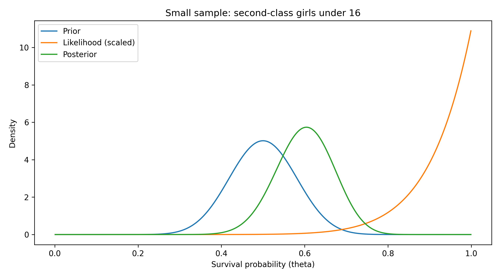

*Figure 5. Prior, scaled likelihood and posterior for second-class girls under 16 (n = 10, k = 10). Blue is the Beta(20, 20) prior, orange is the scaled likelihood and green is the Beta(30, 20) posterior.*

## Case 2: Larger sample — third-class men

For the large-sample example, we consider male passengers travelling in third class on the Titanic. The sample contains 347 passengers, of whom 47 survived.

The observed survival rate is

$$
\frac{k}{n}=\frac{47}{347}\approx 0.135
$$

We use the same prior distribution as in the small-sample example:

$$
\theta \sim \text{Beta}(20,20)
$$

With $k=47$ survivors and $n=347$ passengers, the posterior distribution is

$$
\theta \mid \text{data}
\sim \text{Beta}(20+47,\ 20+347-47)
$$

$$
\theta \mid \text{data}
\sim \text{Beta}(67,320)
$$

The posterior mean is

$$
E[\theta \mid \text{data}]
=\frac{67}{67+320}
\approx 0.173
$$

The 95% credible interval is approximately

$$
(0.137,\ 0.212)
$$

Figure 6 shows the larger-sample update, where the posterior lies closer to the likelihood than to the prior.

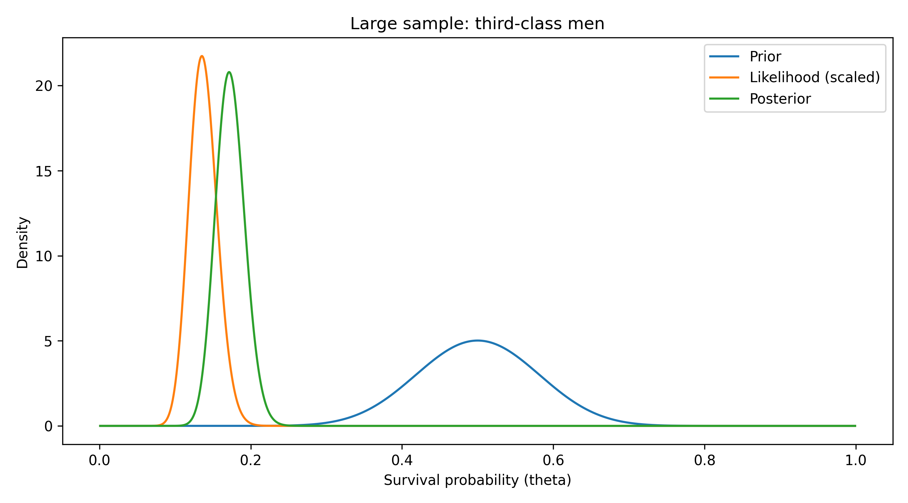

*Figure 6. Prior, scaled likelihood and posterior for third-class men (n = 347, k = 47). Blue is the Beta(20, 20) prior, orange is the scaled likelihood and green is the Beta(67, 320) posterior.*

| Passenger group | Observed survival | Posterior mean |
|---|---:|---:|
| Second-class girls under 16 | 10/10 = 100% | 60.0% |
| Third-class men | 47/347 = 13.5% | 17.3% |

**Comparison of the 95% credible intervals**

The 95% credible interval for the small sample is (0.462, 0.730), with a width of 0.268. For the large sample, the interval is (0.137, 0.212), with a width of 0.075.

## Task 3: Naive Bayes Classification

The classifier and experiments are implemented in `src/task3_naive_bayes.py`. Its `fit_naive_bayes()` and `predict_proba()` functions are also reused in Task 4.

The Naive Bayes classifier was implemented using the synthetic maize dataset generated in Task 1. The target variable is `y`, where `y = 0` represents a healthy plant and `y = 1` represents an unhealthy plant.

For numerical features, the classifier uses a Gaussian likelihood estimated separately for each class. For the categorical feature `cat`, it estimates category probabilities from class-specific counts. Laplace smoothing is used by default for categorical probabilities. The model assumes that the features are conditionally independent given the class, so the feature likelihoods are multiplied together with the class prior. The resulting class scores are normalized to obtain posterior class probabilities.

### Task 3a — Hand-calculation support

Task 3a uses only `f1` and `cat` for the selected test point. The code prints the class priors, the Gaussian density for `f1`, the categorical likelihood for `cat`, the unnormalized class scores, and the normalized posterior probabilities. These values support the hand calculation presented separately in the assignment.

For the selected test point (`f1 = 23.019741`, `cat = No treatment`), the model predicts class `0` (healthy). The calculated posterior probabilities are:

- `P(y = 0 | x) = 0.999515`
- `P(y = 1 | x) = 0.000485`

The code output is intended as a numerical check for the hand calculation; the derivation and explanation of each factor are provided separately.

Table 3 lists the class-specific factors for the selected plant. The main
columns for checking the handwritten steps are `prior`, `gaussian_density_f1`,
`categorical_likelihood` and `unnormalized_score`. The score is the product of
the prior and the two likelihoods. Adding the two class scores gives the
normalization denominator; dividing the class-1 score by that sum gives the
unhealthy posterior to compare with the classifier result reported above.
The final posteriors are not a column in this CSV and are shown in the Visual Studio terminal only.

`f1_mean` and `f1_sample_sd` specify the fitted Gaussian, while `category` and
`category_count` identify the treatment and its class-specific training count.
`class_y` identifies which health class each row describes. The reference
result is calculated by the code. It is provided so you can compare it with
your own handwritten calculation; it does not replace that calculation.

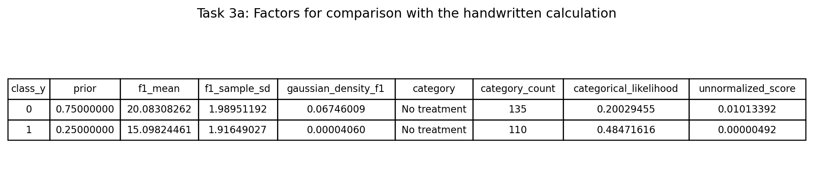

*Table 3. All nine columns from task3a_hand_calculation_factors.csv. Values are
shown to eight decimal places; the CSV retains full precision. Class 0 is
healthy and class 1 is unhealthy.*

### Task 3b — Effect of categorical smoothing

The experiment compares categorical smoothing with alpha = 0 and alpha = 1. The three class-1 training observations with `cat = Enhanced protection` were removed from the training data for this experiment only. The test point was kept unchanged and was not used to fit the model.

Table 4 identifies the plant used in both smoothing settings. Its four
numerical features and treatment are the classifier inputs. The plant ID and
coordinates are metadata; the recorded class `y = 0` is shown for context and
is not supplied as a predictor.

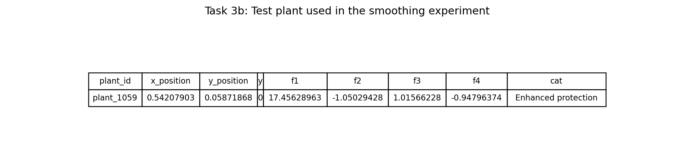

*Table 4. All nine columns from task3b_test_plant.csv for plant_1059. Positions
are relative field coordinates, f1 is ear length in centimetres, f2–f4 are
standardized measurements, and cat is the treatment. Numerical measurements
are shown to eight decimal places.*

Without smoothing (`alpha = 0`), the category `Enhanced protection` has zero observations in class `y = 1`, so:

- `P(cat = Enhanced protection | y = 1) = 0`
- The resulting posterior probability for class `y = 1` is `0`.

| Result | No smoothing (`alpha = 0`) | Laplace smoothing (`alpha = 1`) |
|---|---:|---:|
| `P(Enhanced protection \|  y = 0)` | 0.303704 | 0.303387 |
| `P(Enhanced protection \| y = 1)` | 0.000000 | 0.004425 |
| `P(y = 1 \| x)` | 0.000000 | 0.003235 |

Table 5 records the same test point evaluated without and with Laplace smoothing, using the same reduced training set.

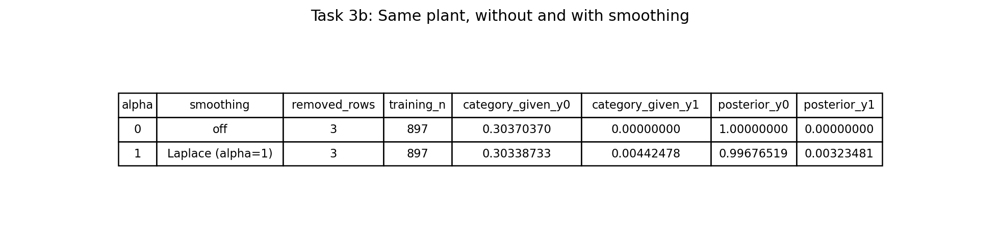

*Table 5. Category likelihoods and posterior probabilities in the smoothing experiment. Three unhealthy training rows are removed only for this experiment, leaving 897 training plants.*

Figure 7 highlights the change from an exactly zero unhealthy posterior to a small positive value when smoothing is enabled.

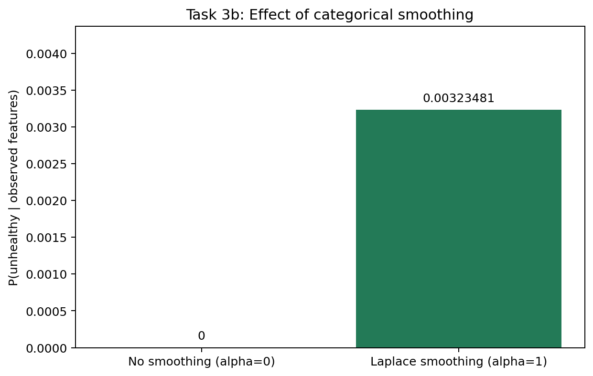

*Figure 7. Posterior probability of y = 1 for the fixed test plant without smoothing (alpha = 0) and with Laplace smoothing (alpha = 1). Bar values are probabilities, not percentages.*

### Task 3c — Feature subset selection

To investigate which features are useful, seven predefined feature subsets were compared using stratified five-fold cross-validation on the training data. The subsets were ranked by their mean F1-score. The subset with the highest mean F1-score was selected, with fewer features preferred in the event of a tie.

Table 6 summarizes the training-only cross-validation results for the seven manually chosen feature subsets.

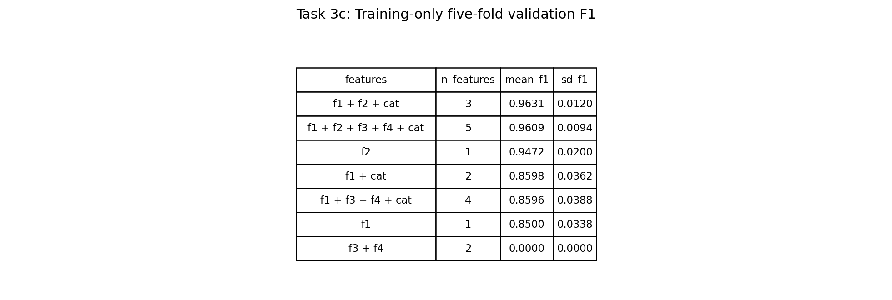

*Table 6. Mean unhealthy-class F1 and sample standard deviation across five stratified validation folds. The held-out test set is not used to rank subsets.*

Figure 8 compares the subset scores and their fold-to-fold variability; the two highest mean scores are close.

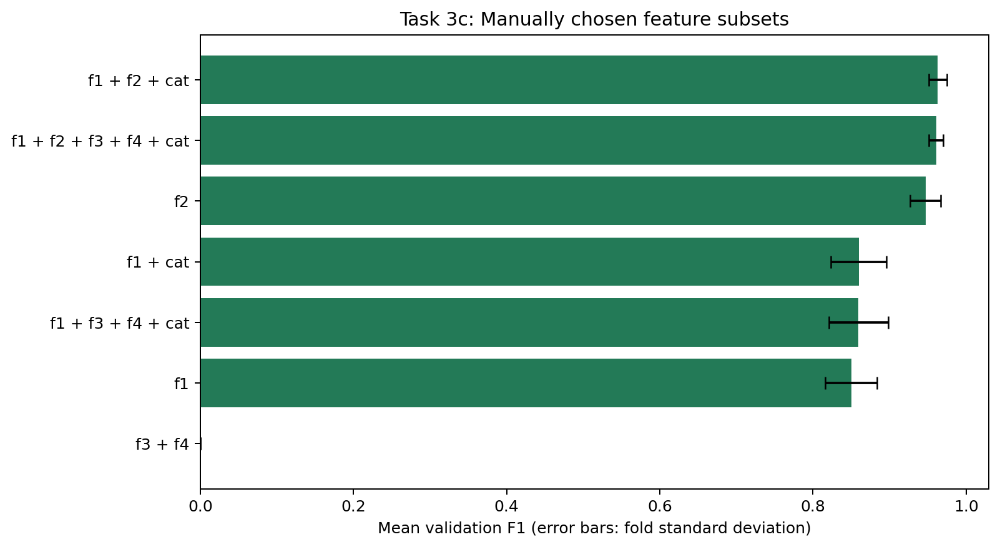

*Figure 8. Mean validation F1 for each feature subset. Error bars show one sample standard deviation across folds, not confidence intervals.*

The selected subset was `f1 + f2 + cat`, with a mean cross-validation F1-score of `0.963062`. Its mean F1-score was `0.002149` higher than the score for all five features (`0.960913`). 

After feature selection, the selected subset and the model using all five features were evaluated on the same held-out test set. Table 7 reports their accuracy, precision, recall and F1-score, treating unhealthy plants as the positive class.


*Table 7. Held-out test accuracy, precision, recall and F1 for all five features and the selected f1 + f2 + cat subset. Unhealthy plants are the positive class.*

Figure 9 shows the full five-feature model's individual error counts: six healthy plants are flagged as unhealthy and two unhealthy plants are missed.

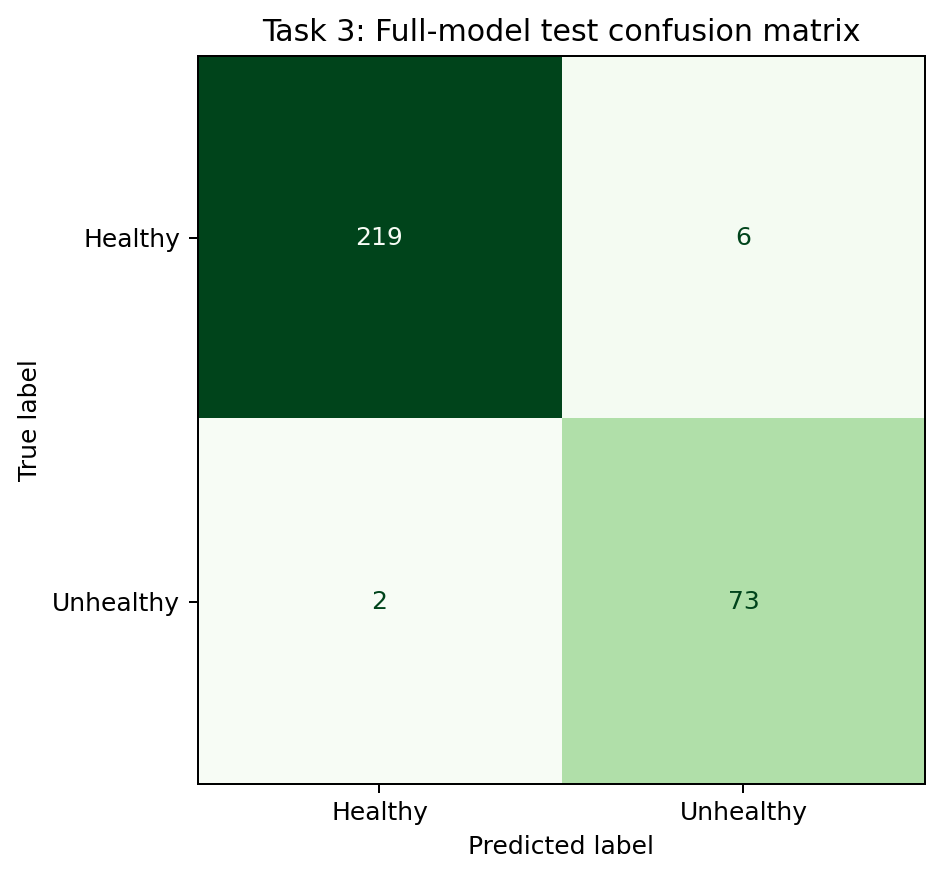

*Figure 9. Full-model confusion matrix for 300 held-out test plants. Rows are true classes, columns are predicted classes and the diagonal entries are correct predictions.*

## Task 4 – Comparing Naive Bayes and a Decision Tree

### 4.1 Models and evaluation procedure

The experiments are implemented in `src/task4_compare_models.py`. It imports the classifier functions from Task 3 and fits new models on each Task 4 training split; it does not reuse a fitted Task 3 model.

Task 4 compares the Naive Bayes classifier implemented in Task 3 with a single `DecisionTreeClassifier` from scikit-learn. Both models use the features `f1`, `f2`, `f3`, `f4`, and `cat`. The categorical feature is one-hot encoded for the Decision Tree, while the numerical features are passed through unchanged.

The models are evaluated using three train-test split strategies:

- **Split A – Biased split:** All observations with `y = 1` are placed in the training set, and all observations with `y = 0` are placed in the test set.
- **Split B – Random split:** The dataset is randomly divided into 80% training and 20% testing without stratification. Five random seeds are used: 42, 43, 44, 45, and 46.
- **Split C – Stratified split:** The dataset is divided into 80% training and 20% testing while preserving the class proportions. The same five seeds are used.

Both models are evaluated on the same split for each experiment.

### 4.2 Class balance and test error rate

Table 8 combines the number and percentage of unhealthy observations (`y = 1`)
in the training and test sets with the test error rate and sensitivity for each
model and split. Splits B and C show the results separately for each of the
five seeds. The across-seed summary reports the mean sensitivity and its sample
standard deviation within each split/model group; the standard deviation is
expressed in percentage points. The notes identify undefined results in Split A.


*Table 8. Combined Task 4 results from task4_results.csv, task4_class_balance.csv and task4_sensitivity_summary.csv. Error and sensitivity are percentages; SD (pp) is the across-seed sample standard deviation in percentage points. N/A denotes undefined values, not zero.*

For Split A, Naive Bayes model produced undefined posterior probabilities because class `y = 0` was absent from the training data. Therefore, its test error rate is reported as **N/A**, rather than assigning an artificial value. The Decision Tree fit the single class present in training, predicted `y = 1` for the test observations, and consequently had a 100% test error rate.

### 4.3 Mean results across repeated splits

For Split B and Split C, the mean test error rates across the five seeds were:

| Split | Model | Mean test error rate |
|---|---|---:|
| B – Random | Naive Bayes | 1.92% |
| B – Random | Decision Tree | 2.75% |
| C – Stratified | Naive Bayes | 2.25% |
| C – Stratified | Decision Tree | 2.17% |

These mean values summarize the five experiments. The individual results in Table 8 show the variation across seeds.

### 4.4 Sensitivity

Sensitivity, also known as recall for the positive class, measures the proportion of actual `y = 1` observations correctly identified:

$$
\text{Sensitivity}=\frac{TP}{TP+FN}
$$

where `TP` is the number of true positives and `FN` is the number of false negatives.

The mean sensitivity and standard deviation across the five seeds were:

| Split | Model | Mean sensitivity | SD across seeds |
|---|---|---:|---:|
| A – Biased | Naive Bayes | N/A | N/A |
| A – Biased | Decision Tree | N/A | N/A |
| B – Random | Naive Bayes | 0.9778 | 0.0213 |
| B – Random | Decision Tree | 0.9517 | 0.0226 |
| C – Stratified | Naive Bayes | 0.9867 | 0.0139 |
| C – Stratified | Decision Tree | 0.9767 | 0.0149 |

Sensitivity is undefined for Split A because the test set contains no positive observations (`y = 1`). It must not be reported as zero. The sensitivity plot shows the means and standard deviations for Split B and Split C; the standard deviation represents variation between the five runs and is not a confidence interval.

Figure 10 compares sensitivity across splitting strategies and shows the variability across seeds for Splits B and C.

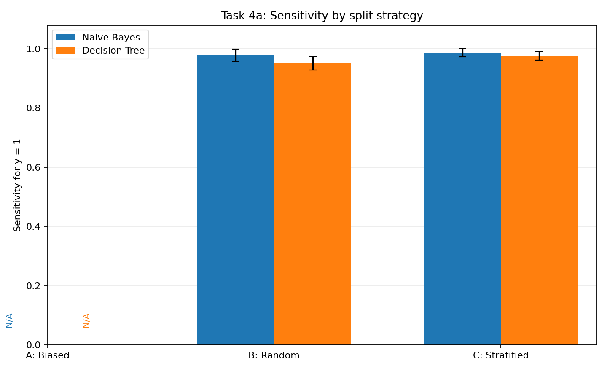

*Figure 10. Sensitivity for Naive Bayes (blue) and the Decision Tree (orange). For Splits B and C, bars show the mean across five seeds and error bars show one sample standard deviation. Split A is labelled N/A because there are no unhealthy test plants.*

### 4b. Numerical record

Split A contains 300 unhealthy training plants and 900 healthy test plants.
The Naive Bayes implementation returns undefined posteriors because the training
set has no class-0 observations. The Decision Tree predicts class 1 for all test
plants, giving 100% error. Sensitivity is N/A for both models: the test set has
no positive observations, so TP + FN = 0.

For Split B, the unhealthy proportion ranges from 24.17% to 25.10% in training
and from 24.58% to 28.33% in testing. Split C contains 240 unhealthy plants out
of 960 in training and 60 out of 240 in testing for every seed (25% in each).

| Model | Split B error SD (pp) | Split C error SD (pp) | Split B sensitivity SD (pp) | Split C sensitivity SD (pp) |
|---|---:|---:|---:|---:|
| Naive Bayes | 1.13 | 0.76 | 2.13 | 1.39 |
| Decision Tree | 1.60 | 1.16 | 2.26 | 1.49 |

SD is the sample standard deviation across the five seeds; pp means percentage
points. Mean error rates and sensitivities are reported above and in Table 8.

A constant class-0 predictor would classify all 900 healthy plants correctly
and miss all 300 unhealthy plants: accuracy 75%, error 25%, sensitivity 0%.

### Task 4 combined results table

`src/table_of_results.py` creates `figures/task4_results_table.png`, combining
`task4_results.csv`, `task4_class_balance.csv` and `task4_sensitivity_summary.csv`.
The table includes per-seed class balance and performance, plus mean sensitivity
and its standard deviation across seeds. The summary repeats for each seed of
its split/model group; standard deviations are in percentage points.
Footnotes explain undefined Split A values and identify all three source CSVs.

`task4_compare_models.py` calls `save_results_table(PROJECT_DIR)` after saving
the CSVs. The table can also be refreshed independently from existing results,
without retraining, using the command in the following section.

## Code organization and execution

All six Python scripts are stored in `src/`. CSV inputs and results are stored
in `data/`, and plots and table images are stored in `figures/`.

| Script in `src/` | Purpose | Inputs and dependencies | Main outputs |
|---|---|---|---|
| `task1_generate.py` | Generate the fixed-seed synthetic maize dataset and describe its features. | NumPy random generator with seed 42; no input dataset. | Maize CSV, class/category summaries, diagnostics and Task 1 images. |
| `Beta-Binomial model (task 2a).py` | Update a Beta prior using the observed number of unhealthy plants. | `data/task1_synthetic_data.csv` from Task 1. | Posterior parameters, mean, mode and credible interval printed in the terminal. |
| `Prior_influence (task 2b).py` | Compare prior influence in small and large Titanic passenger groups. | Titanic data loaded through Seaborn; independent of the maize dataset. | Posterior summaries printed in the terminal and two Task 2b plots. |
| `task3_naive_bayes.py` | Fit the mixed Naive Bayes model and run subtasks 3a–3c. | Maize CSV; imports `CATEGORIES` and `generate_dataset()` from Task 1. | Split records, fitted factors, smoothing results, feature-subset scores, test metrics, environment record and Task 3 images. |
| `task4_compare_models.py` | Compare Naive Bayes and a Decision Tree on biased, random and stratified splits. | Maize CSV; imports Task 1's generator, Task 3's classifier functions and `save_results_table()` from `table_of_results.py`. | Three Task 4 CSVs, sensitivity chart and combined results table image. |
| `table_of_results.py` | Render the combined Task 4 results table. | `task4_results.csv`, `task4_class_balance.csv` and `task4_sensitivity_summary.csv`. | `figures/task4_results_table.png`. |

### Relationships between scripts

Task 1 creates the maize CSV consumed by Tasks 2a, 3 and 4. Tasks 3 and 4 can
recreate that CSV with the Task 1 generator if it is missing; running Task 1
first also produces its complete descriptive outputs. Task 2b uses a separate
Titanic dataset and does not depend on the maize workflow.

Task 4 reuses Task 3's classifier functions and feature list, but estimates new
model parameters from each of its own training splits. Importing the Task 1
and Task 3 functions does not run their main workflows. Task 3 therefore does
not need to be executed before Task 4, although its script must be present.

After saving the Task 4 CSVs, Task 4 calls the table module. The table module
can also run by itself once those three CSVs exist; it does not train models.

### Execution commands

The active project root is `...\assig_2_mod550_g5`. Its `src/`,
`data/` and `figures/` folders contain the working code, datasets and images.
Earlier versions are archived in `_drafts/` and are not used by the active workflow.

Run the following commands from the repository root, not from `src/` or
`_drafts/`.

If running from PowerShell, quotation marks are needed around the two Python filenames containing spaces.
The Task 2a script resolves its data path from its own location, so it can also
be launched from another working folder by supplying the script's full path.

```text
python src/task1_generate.py
python "src/Beta-Binomial model (task 2a).py"
python "src/Prior_influence (task 2b).py"
python src/task3_naive_bayes.py
python src/task4_compare_models.py
```

The final command already creates the combined Task 4 table. To refresh only
that image from the existing CSVs:

```text
python src/table_of_results.py
```

The scripts require NumPy, pandas, Matplotlib, SciPy, scikit-learn and Seaborn.
Seaborn may need internet access when the Titanic dataset is not cached.
Task 2a prints results without saving new files. Task 2b saves its plots and
also opens plot windows. The other main scripts regenerate their own result
files and images when rerun.

